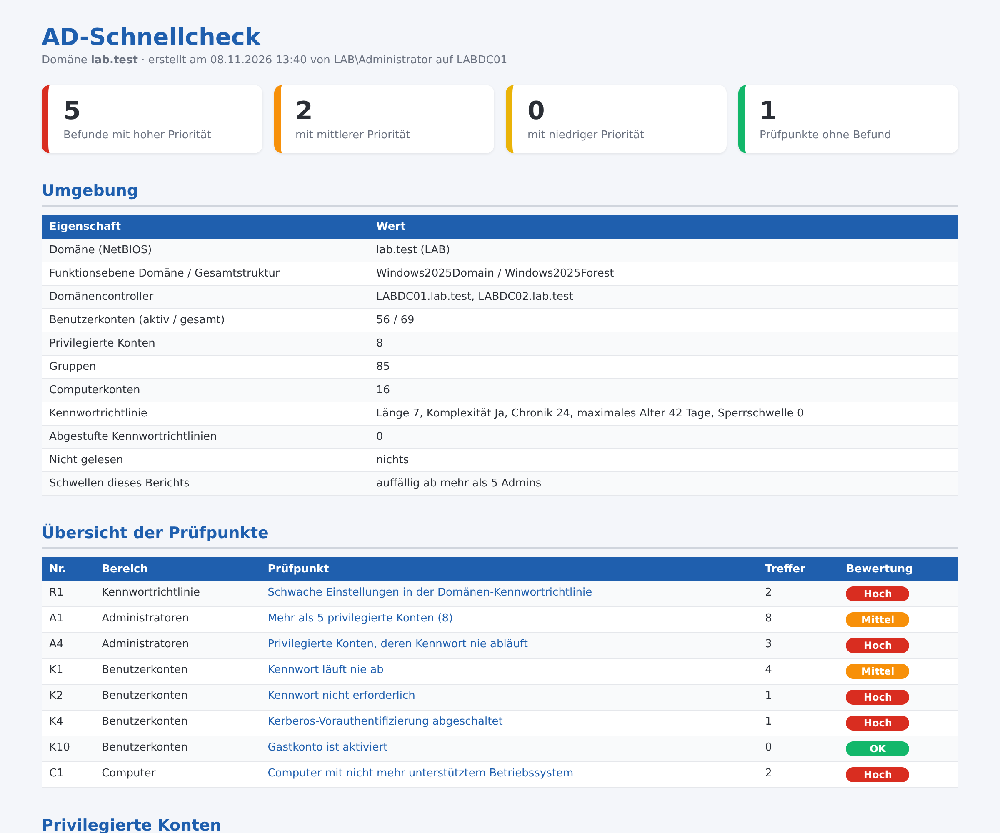

# AD-Schnellcheck – kostenloser Active-Directory-Check mit PowerShell

PowerShell-Skript, das ein Active Directory in **8 Punkten** auf typische Schwachstellen prüft und einen übersichtlichen **HTML-Bericht auf Deutsch** erzeugt. Es arbeitet **ausschließlich lesend**: Es ändert nichts im Verzeichnis, legt nichts an und überträgt keine Daten.



## Was geprüft wird

| Nr. | Prüfpunkt |
|---|---|
| R1 | Schwache Einstellungen in der Domänen-Kennwortrichtlinie (Länge, Komplexität, Chronik, Kontosperrung) |
| A1 | Zu viele privilegierte Konten (auch über verschachtelte Gruppen) |
| A4 | Administratorkonten, deren Kennwort nie abläuft |
| K1 | Benutzerkonten, deren Kennwort nie abläuft |
| K2 | Konten, die kein Kennwort brauchen (PASSWD_NOTREQD) |
| K4 | Kerberos-Vorauthentifizierung abgeschaltet (AS-REP-Roasting) |
| K10 | Gastkonto aktiviert |
| C1 | Computer mit nicht mehr unterstütztem Windows (bis Windows 10, Server 2012 R2) |

Jeder Befund kommt mit Erklärung und Empfehlung; auf Wunsch zusätzlich als CSV für Excel.

## Start

```powershell
powershell -ExecutionPolicy Bypass -File .\AD-Schnellcheck.ps1
```

Optionen: `-Csv` (CSV je Befund), `-Ausgabe C:\Berichte\ad.html`, `-MaxAdmins 5`, `-Server <DC>`, `-Anmeldung (Get-Credential)` (z. B. von einem Rechner außerhalb der Domäne), `-NichtOeffnen`, `-PassThru`.

**Voraussetzungen:** Windows PowerShell 5.1, PowerShell-Modul `ActiveDirectory` (auf Domänencontrollern vorhanden, sonst RSAT), ein normales Domänenkonto mit Leserechten. Administratorrechte sind nicht nötig.

Getestet mit Windows Server 2019, 2022 und 2025 in Testdomänen (deutsches Windows).

## Vollversion

Der Schnellcheck ist eine Kurzfassung des **AD-Prüfberichts** (21 Prüfpunkte, Anleitung als PDF). Zusätzlich geprüft werden dort u. a. Dienstkonten mit Administratorrechten, Konten mit SPN (Kerberoasting), mögliche Kennwörter im Beschreibungsfeld, deaktivierte Admin-Konten, verschachtelte Admin-Gruppen, inaktive Benutzer- und Computerkonten, das Alter des krbtgt-Kennworts, leere Gruppen und der AD-Papierkorb.

Weitere Prüfskripte (alle nur lesend, mit HTML-Bericht): Domänencontroller-Gesundheit, DNS/DHCP, Rechner-Inventar mit Support-Ende, Kerberos-Altlasten, Berechtigungen, Gruppenrichtlinien, Anmelde- und Sperrbericht, Dateiserver.

➜ **[AD-Prüfbericht (Vollversion) auf Gumroad](https://mueller86.gumroad.com/l/fcneoc)** · **[alle Skripte auf Gumroad](https://mueller86.gumroad.com)** · **[IT Admin Tools by MM auf Etsy](https://www.etsy.com/shop/ITAdminToolsbyMM)**

## Hinweise

- Der Bericht enthält Konto- und Rechnernamen – bitte vertraulich behandeln.
- Der Bericht zeigt Auffälligkeiten anhand fester Regeln. Er ersetzt keine Sicherheitsprüfung und erhebt keinen Anspruch auf Vollständigkeit.
- Nutzung auf eigene Verantwortung, siehe [LICENSE](LICENSE).
- Bei der Ausarbeitung wurden KI-Werkzeuge unterstützend eingesetzt; Inhalte und Skript wurden fachlich geprüft und im Testlab getestet.

---

### English

Free PowerShell script that checks an Active Directory domain for 8 common weaknesses (password policy, privileged accounts, accounts without password requirement, AS-REP roasting, guest account, unsupported Windows versions) and writes an HTML report. Read-only, no changes, no data transfer. Report language is German. Full version: https://mueller86.gumroad.com/l/fcneoc
