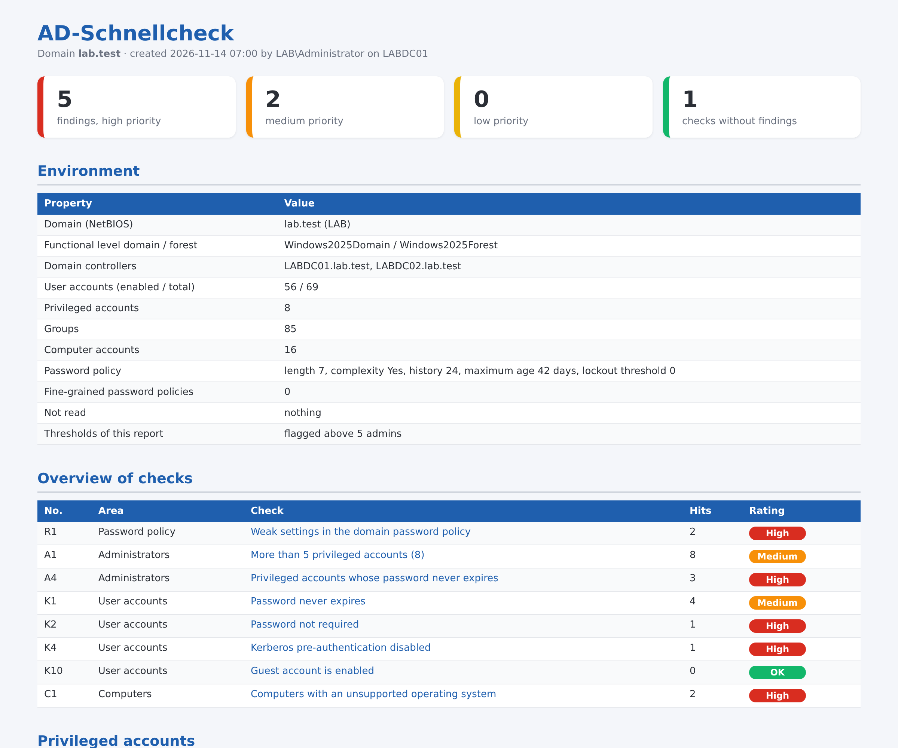

# AD-Schnellcheck – free Active Directory check with PowerShell

PowerShell script that checks an Active Directory for typical weaknesses across **8 checks** and generates a clear **HTML report in German or English** (`-Language de|en`, default based on Windows language). It operates **read-only**: it changes nothing in the directory, creates nothing, and transfers no data.



Sample report from the test lab: [German](Beispielbericht.html) · [English](Beispielbericht_en.html)

## What is checked

| No. | Check |
|---|---|
| R1 | Weak settings in the domain password policy (length, complexity, history, account lockout) |
| A1 | Too many privileged accounts (including nested groups) |
| A4 | Admin accounts whose password never expires |
| K1 | User accounts whose password never expires |
| K2 | Accounts that do not require a password (PASSWD_NOTREQD) |
| K4 | Kerberos pre-authentication disabled (AS-REP roasting) |
| K10 | Guest account enabled |
| C1 | Computers running unsupported Windows (up to Windows 10, Server 2012 R2) |

Each finding includes an explanation and recommendation; optionally also as CSV for Excel.

## Start

```powershell
powershell -ExecutionPolicy Bypass -File .\AD-Schnellcheck.ps1
```

Options: `-Csv` (CSV per finding), `-Output C:\Berichte\ad.html` (alias: `-Ausgabe`), `-MaxAdmins 5`, `-Server <DC>`, `-Credential (Get-Credential)` (alias: `-Anmeldung`; e.g. from a computer outside the domain), `-NoOpen` (alias: `-NichtOeffnen`), `-PassThru`, `-Language de|en`.

**Requirements:** Windows PowerShell 5.1, PowerShell module `ActiveDirectory` (present on domain controllers, otherwise RSAT), a normal domain account with read permissions. Administrator rights are not required.

Tested with Windows Server 2019, 2022, and 2025 in test domains (German Windows); the English report was produced in the same lab.

## Queries by hand

If you do not want to run the script, you can query the core checks individually. All read-only and language-independent (fixed identifiers instead of group names), tested under Windows Server 2025 (German).

```powershell
$sid = (Get-ADDomain).DomainSID.Value
# Password policy
Get-ADDefaultDomainPasswordPolicy | Select MinPasswordLength, ComplexityEnabled, PasswordHistoryCount, LockoutThreshold
# Domain admins (RID 512), resolved recursively
Get-ADGroupMember "$sid-512" -Recursive | Select SamAccountName, objectClass
# Admins with passwords that never expire
Get-ADGroupMember "$sid-512" -Recursive | Get-ADUser -Properties PasswordNeverExpires | Where PasswordNeverExpires | Select SamAccountName
# Users whose passwords never expire
Get-ADUser -Filter 'PasswordNeverExpires -eq $true -and Enabled -eq $true' | Select SamAccountName
# Accounts without password requirement
Get-ADUser -Filter 'PasswordNotRequired -eq $true -and Enabled -eq $true' | Select SamAccountName
# Kerberos pre-authentication disabled (AS-REP roasting)
Get-ADUser -Filter 'DoesNotRequirePreAuth -eq $true' | Select SamAccountName
# Guest account (RID 501)
Get-ADUser "$sid-501" -Properties Enabled | Select SamAccountName, Enabled
# Outdated Windows versions (LTSC excluded)
Get-ADComputer -Filter 'Enabled -eq $true' -Properties OperatingSystem |
  Where { $_.OperatingSystem -match 'Windows (7|8|10|XP|Vista)|Server 2008|Server 2012' -and $_.OperatingSystem -notmatch 'LTSC|LTSB' } |
  Select Name, OperatingSystem
```

## Full version

The quick check is a short edition of the **AD-Prüfbericht (AD Audit Report)** (21 checks, instructions as PDF). It also checks, among other things, service accounts with administrator rights, accounts with SPNs (Kerberoasting), possible passwords in the description field, disabled admin accounts, nested admin groups, inactive user and computer accounts, the age of the krbtgt password, empty groups, and the AD recycle bin.

Additional check scripts (all read-only, with HTML report): domain controller health, DNS/DHCP, computer inventory with end-of-support, Kerberos legacy items, permissions, group policies, logon and lockout report, file server.

➜ **[AD-Prüfbericht (full version) on Gumroad](https://mueller86.gumroad.com/l/fcneoc)** · **[all scripts on Gumroad](https://mueller86.gumroad.com)** · **[IT Admin Tools by MM on Etsy](https://www.etsy.com/shop/ITAdminToolsbyMM)**

## Additional free check scripts

Each with sample report, read-only:

- [Computer Inventory Light](https://github.com/jackyno7/rechner-inventar-light) · [Logon and Lockout Report Light](https://github.com/jackyno7/anmelde-sperrbericht-light) · [Permissions Report Light](https://github.com/jackyno7/berechtigungsbericht-light)
- [File Server Report Light](https://github.com/jackyno7/dateiserver-bericht-light) · [GPO Report Light](https://github.com/jackyno7/gpo-bericht-light) · [Kerberos Legacy Check Light](https://github.com/jackyno7/kerberos-altlasten-check-light)
- [DNS-DHCP Report Light](https://github.com/jackyno7/dns-dhcp-bericht-light) · [DC Health Report Light](https://github.com/jackyno7/dc-gesundheitsbericht-light)

## Notes

- The report contains account and computer names – please treat as confidential.
- The report shows anomalies based on fixed rules. It does not replace a security audit and makes no claim to completeness.
- Use at your own risk, see [LICENSE](LICENSE).
- During preparation, AI tools were used as support; content and script were technically reviewed and tested in the test lab.

<!-- querverweis:anfang -->
## Alle Skripte und Vorlagen

Übersicht aller Prüfskripte und Vorlagen: **[github.com/jackyno7](https://github.com/jackyno7)**

Vollversionen:

- Active Directory Prüfbericht: [Etsy](https://www.etsy.com/listing/4588853943) · [Gumroad](https://mueller86.gumroad.com/l/fcneoc)
- Domänencontroller-Gesundheitsbericht: [Etsy](https://www.etsy.com/listing/4593087246) · [Gumroad](https://mueller86.gumroad.com/l/bseljr)
- DNS- und DHCP-Bericht: [Etsy](https://www.etsy.com/listing/4593096270) · [Gumroad](https://mueller86.gumroad.com/l/sthgh)
- Kerberos- und Altlasten-Check: [Etsy](https://www.etsy.com/listing/4593092377) · [Gumroad](https://mueller86.gumroad.com/l/zptvct)
- Berechtigungsbericht Active Directory: [Etsy](https://www.etsy.com/listing/4593113568) · [Gumroad](https://mueller86.gumroad.com/l/xyjmdr)
- GPO-Bericht: [Etsy](https://www.etsy.com/listing/4593129111) · [Gumroad](https://mueller86.gumroad.com/l/wdosl)
- Anmelde- und Sperrbericht: [Etsy](https://www.etsy.com/listing/4593157082) · [Gumroad](https://mueller86.gumroad.com/l/ztktaaq)
- Rechner-Inventar aus Active Directory: [Etsy](https://www.etsy.com/listing/4593088535) · [Gumroad](https://mueller86.gumroad.com/l/zzycdd)
- Dateiserver-Bericht: [Etsy](https://www.etsy.com/listing/4612420692) · [Gumroad](https://mueller86.gumroad.com/l/wbbwj)
- Windows-Rechnerbericht: [Etsy](https://www.etsy.com/listing/4616020701) · [Gumroad](https://mueller86.gumroad.com/l/wmhfk)
- Exchange-Postfachbericht: [Etsy](https://www.etsy.com/listing/4614916333) · [Gumroad](https://mueller86.gumroad.com/l/gkdllj)
- Exchange-Kalenderrechte-Bericht: [Etsy](https://www.etsy.com/listing/4614799790) · [Gumroad](https://mueller86.gumroad.com/l/iabfb)
- Exchange-Nachrichtenverfolgung: [Etsy](https://www.etsy.com/listing/4614785975) · [Gumroad](https://mueller86.gumroad.com/l/msria)
- Active Directory Prüfskript-Paket: [Etsy](https://www.etsy.com/listing/4611942401) · [Gumroad](https://mueller86.gumroad.com/l/awzjtc)

Vorlagen und Checklisten (Notfallplan, Backup, Passwortrichtlinie, Onboarding, Homeoffice, Netzwerk-Dokumentation): [Etsy](https://www.etsy.com/shop/ITAdminToolsbyMM) · [Gumroad](https://mueller86.gumroad.com)
<!-- querverweis:ende -->

---

## Deutsch: AD-Schnellcheck – kostenloser Active-Directory-Check mit PowerShell

PowerShell-Skript, das ein Active Directory in **8 Punkten** auf typische Schwachstellen prüft und einen übersichtlichen **HTML-Bericht auf Deutsch oder Englisch** (`-Language de|en`, Standard je nach Windows-Sprache) erzeugt. Es arbeitet **ausschließlich lesend**: Es ändert nichts im Verzeichnis, legt nichts an und überträgt keine Daten.


Beispielbericht aus dem Testlab: [deutsch](Beispielbericht.html) · [englisch](Beispielbericht_en.html)

## Was geprüft wird

| Nr. | Prüfpunkt |
|---|---|
| R1 | Schwache Einstellungen in der Domänen-Kennwortrichtlinie (Länge, Komplexität, Chronik, Kontosperrung) |
| A1 | Zu viele privilegierte Konten (auch über verschachtelte Gruppen) |
| A4 | Administratorkonten, deren Kennwort nie abläuft |
| K1 | Benutzerkonten, deren Kennwort nie abläuft |
| K2 | Konten, die kein Kennwort brauchen (PASSWD_NOTREQD) |
| K4 | Kerberos-Vorauthentifizierung abgeschaltet (AS-REP-Roasting) |
| K10 | Gastkonto aktiviert |
| C1 | Computer mit nicht mehr unterstütztem Windows (bis Windows 10, Server 2012 R2) |

Jeder Befund kommt mit Erklärung und Empfehlung; auf Wunsch zusätzlich als CSV für Excel.

## Start

```powershell
powershell -ExecutionPolicy Bypass -File .\AD-Schnellcheck.ps1
```

Optionen: `-Csv` (CSV je Befund), `-Output C:\Berichte\ad.html` (alt: `-Ausgabe`), `-MaxAdmins 5`, `-Server <DC>`, `-Credential (Get-Credential)` (alt: `-Anmeldung`; z. B. von einem Rechner außerhalb der Domäne), `-NoOpen` (alt: `-NichtOeffnen`), `-PassThru`, `-Language de|en`.

**Voraussetzungen:** Windows PowerShell 5.1, PowerShell-Modul `ActiveDirectory` (auf Domänencontrollern vorhanden, sonst RSAT), ein normales Domänenkonto mit Leserechten. Administratorrechte sind nicht nötig.

Getestet mit Windows Server 2019, 2022 und 2025 in Testdomänen (deutsches Windows).

## Die Abfragen auch von Hand

Wer das Skript nicht ausführen will, kann die Kernprüfungen einzeln abfragen. Alle nur lesend und sprachunabhängig (feste Kennungen statt Gruppennamen), getestet unter Windows Server 2025 (deutsch).

```powershell
$sid = (Get-ADDomain).DomainSID.Value
# Kennwortrichtlinie
Get-ADDefaultDomainPasswordPolicy | Select MinPasswordLength, ComplexityEnabled, PasswordHistoryCount, LockoutThreshold
# Domänen-Admins (RID 512), verschachtelt aufgelöst
Get-ADGroupMember "$sid-512" -Recursive | Select SamAccountName, objectClass
# Admins mit Kennwort, das nie abläuft
Get-ADGroupMember "$sid-512" -Recursive | Get-ADUser -Properties PasswordNeverExpires | Where PasswordNeverExpires | Select SamAccountName
# Benutzer, deren Kennwort nie abläuft
Get-ADUser -Filter 'PasswordNeverExpires -eq $true -and Enabled -eq $true' | Select SamAccountName
# Konten ohne Kennwortpflicht
Get-ADUser -Filter 'PasswordNotRequired -eq $true -and Enabled -eq $true' | Select SamAccountName
# Kerberos-Vorauthentifizierung aus (AS-REP-Roasting)
Get-ADUser -Filter 'DoesNotRequirePreAuth -eq $true' | Select SamAccountName
# Gastkonto (RID 501)
Get-ADUser "$sid-501" -Properties Enabled | Select SamAccountName, Enabled
# Veraltete Windows-Versionen (LTSC ausgenommen)
Get-ADComputer -Filter 'Enabled -eq $true' -Properties OperatingSystem |
  Where { $_.OperatingSystem -match 'Windows (7|8|10|XP|Vista)|Server 2008|Server 2012' -and $_.OperatingSystem -notmatch 'LTSC|LTSB' } |
  Select Name, OperatingSystem
```

## Vollversion

Der Schnellcheck ist eine Kurzfassung des **AD-Prüfberichts** (21 Prüfpunkte, Anleitung als PDF). Zusätzlich geprüft werden dort u. a. Dienstkonten mit Administratorrechten, Konten mit SPN (Kerberoasting), mögliche Kennwörter im Beschreibungsfeld, deaktivierte Admin-Konten, verschachtelte Admin-Gruppen, inaktive Benutzer- und Computerkonten, das Alter des krbtgt-Kennworts, leere Gruppen und der AD-Papierkorb.

Weitere Prüfskripte (alle nur lesend, mit HTML-Bericht): Domänencontroller-Gesundheit, DNS/DHCP, Rechner-Inventar mit Support-Ende, Kerberos-Altlasten, Berechtigungen, Gruppenrichtlinien, Anmelde- und Sperrbericht, Dateiserver.

➜ **[AD-Prüfbericht (Vollversion) auf Gumroad](https://mueller86.gumroad.com/l/fcneoc)** · **[alle Skripte auf Gumroad](https://mueller86.gumroad.com)** · **[IT Admin Tools by MM auf Etsy](https://www.etsy.com/shop/ITAdminToolsbyMM)**

## Weitere kostenlose Prüfskripte

Jeweils mit Beispielbericht, nur lesend:

- [Rechner-Inventar Light](https://github.com/jackyno7/rechner-inventar-light) · [Anmelde-Sperrbericht Light](https://github.com/jackyno7/anmelde-sperrbericht-light) · [Berechtigungsbericht Light](https://github.com/jackyno7/berechtigungsbericht-light)
- [Dateiserver-Bericht Light](https://github.com/jackyno7/dateiserver-bericht-light) · [GPO-Bericht Light](https://github.com/jackyno7/gpo-bericht-light) · [Kerberos-Altlasten-Check Light](https://github.com/jackyno7/kerberos-altlasten-check-light)
- [DNS-DHCP-Bericht Light](https://github.com/jackyno7/dns-dhcp-bericht-light) · [DC-Gesundheitsbericht Light](https://github.com/jackyno7/dc-gesundheitsbericht-light)

## Hinweise

- Der Bericht enthält Konto- und Rechnernamen – bitte vertraulich behandeln.
- Der Bericht zeigt Auffälligkeiten anhand fester Regeln. Er ersetzt keine Sicherheitsprüfung und erhebt keinen Anspruch auf Vollständigkeit.
- Nutzung auf eigene Verantwortung, siehe [LICENSE](LICENSE).
- Bei der Ausarbeitung wurden KI-Werkzeuge unterstützend eingesetzt; Inhalte und Skript wurden fachlich geprüft und im Testlab getestet.
